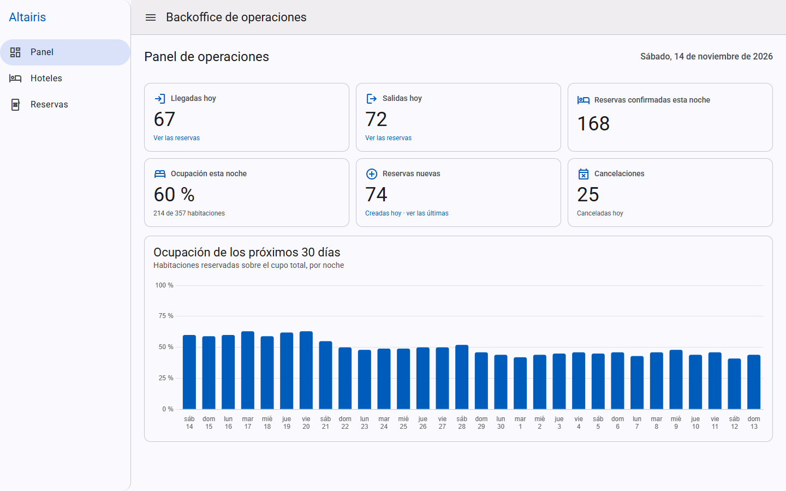

# Altairis · Backoffice de operaciones

MVP navegable del backoffice de operaciones de Viajes Altairis: catálogo de hoteles, tipos de habitación, inventario (cupos), reservas y un panel con el estado de la operativa diaria.



## Puesta en marcha

Solo hace falta Docker (Docker Desktop o Docker Engine con Compose v2) y tener libres los puertos 8080 y 5433:

```bash
docker compose up --build
```

Cuando los tres servicios aparezcan como `healthy`, abre **http://localhost:8080**. La primera vez, construir las imágenes tarda unos minutos; después, los servicios están listos en unos 30 segundos.

| Servicio | Qué es | Acceso |
|---|---|---|
| `web` | Angular servido por nginx, que reenvía `/api` a la API | http://localhost:8080 |
| `api` | API REST en .NET 10 | a través de `web`: http://localhost:8080/api/health · documentación interactiva (Scalar) en http://localhost:8080/api/docs |
| `db` | PostgreSQL 18 | `localhost:5433` (solo desde esta máquina) |

No hace falta ningún `.env`: las credenciales de la base de datos están en `docker-compose.yml` para que todo arranque sin configuración adicional. **Son solo para la demo.**

Al arrancar, la API aplica las migraciones pendientes y, si la base de datos está vacía, carga los datos de ejemplo en unos segundos:

- **Catálogo:** 50.000 hoteles con sus tipos de habitación, para probar la búsqueda con mucho volumen.
- **Cartera contratada:** 40 de esos hoteles tienen cupo (inventario de 60 días atrás a 120 días adelante) y unas 8.000 reservas de agencias, touroperadores, empresas y clientes directos, con cancelaciones y noches agotadas o cerradas a la venta. Sus nombres no se repiten en el catálogo: busca, por ejemplo, "Magnolia" o "Mirabel".

Los hoteles se generan siempre igual. El inventario y las reservas se calculan respecto a la fecha del primer arranque, así que la demo siempre tiene actividad en torno a hoy.

Para volver a empezar con la base de datos vacía: `docker compose down -v`.

## Recorrido de demo (≈ 5 minutos)

1. **Panel** (la página de inicio): llegadas, salidas, reservas confirmadas esta noche, ocupación de esta noche, reservas nuevas y cancelaciones de hoy, y un gráfico con la ocupación de los próximos 30 días. Pulsa "Llegadas hoy".
2. **Reservas:** la lista llega filtrada (confirmadas con entrada hoy) y su total coincide con el del panel. Se puede buscar por localizador, huésped o cliente, filtrar por estado y fechas, y ordenar por columnas. Los filtros viven en la URL: Atrás y recargar conservan la vista.
3. **Hoteles:** busca "Magnolia" entre los 50.000 (la búsqueda no distingue mayúsculas ni acentos: "malaga" encuentra Málaga; también hay filtros por país y categoría, y "Nuevo hotel" para dar de alta uno) y abre "Hotel Boutique Magnolia Zaragoza".
4. **Ficha del hotel:** sus datos y sus tipos de habitación. "Nuevo tipo" añade uno; un nombre repetido devuelve un error claro.
5. **Inventario** (botón en la ficha): calendario de 14 noches por tipo de habitación, con `libres/cupo` y precio en cada celda. Colores: verde por debajo del 70 % de ocupación, ámbar a partir del 70 %, rojo agotado, rayado cerrado a la venta y gris sin cupo. "Editar rango" (o pulsar una celda) cambia cupo, precio o venta en un rango de fechas.
6. **Nueva reserva** (en el inventario, o en Reservas eligiendo antes el hotel): el presupuesto se recalcula mientras se rellena el formulario. Si la estancia no se puede vender, explica el motivo (noche cerrada, sin disponibilidad…). Elige entrada hoy en un tipo de habitación con plazas libres esta noche (celda verde o ámbar en el calendario) y pulsa "Confirmar reserva": se abre la ficha con su localizador `ALT-XXXXXX`.
7. **Efecto en el inventario:** "Ver en el inventario" muestra una habitación menos en las noches reservadas (la noche de salida no se consume). "Cancelar reserva" la devuelve.
8. **Panel** de nuevo: con la reserva confirmada, Llegadas, Reservas confirmadas esta noche y Reservas nuevas suben en uno; tras cancelarla, sube Cancelaciones.

La API se puede probar sin leer código en http://localhost:8080/api/docs.

## Funcionalidades

| Objetivo del enunciado | Qué incluye |
|---|---|
| 1. Administrar hoteles | Alta con validación. Listado paginado en el servidor, con búsqueda por nombre o ciudad sin distinguir mayúsculas ni acentos, filtros por país y categoría y orden por columnas, sobre 50.000 hoteles. Ficha del hotel. |
| 2. Tipos de habitación | Consulta en la ficha del hotel y alta (nombre único por hotel, categoría y ocupación máxima). |
| 3. Disponibilidad e inventario | Cupo, precio y cierre de venta por tipo de habitación y noche. Edición por rangos de fechas. Calendario con colores de ocupación. |
| 4. Reservas | Presupuesto antes de reservar, alta con canal y cliente, y cancelación que libera el inventario. Listado con búsqueda, filtros y accesos "Llegadas hoy" / "Salidas hoy". Panel con los indicadores del día y la ocupación de los próximos 30 días. |

## Arquitectura

```
backend/
  src/
    Altairis.Backoffice.Domain          entidades, value objects, reglas, Result/Error (sin dependencias)
    Altairis.Backoffice.Contracts       DTOs de petición/respuesta (sin dependencias)
    Altairis.Backoffice.Application     servicios por funcionalidad, mapeo DTO ↔ dominio
    Altairis.Backoffice.Infrastructure  EF Core (DbContext, configuraciones, migraciones, datos de ejemplo)
    Altairis.Backoffice.Api             controladores finos, ProblemDetails, OpenAPI + Scalar, health checks
  tests/
    Altairis.Backoffice.Domain.Tests            tests unitarios del dominio
    Altairis.Backoffice.Api.IntegrationTests    API completa contra PostgreSQL real
frontend/   Angular: core/ (layout, interceptor de errores, locale es-ES) · shared/ · features/{dashboard, hotels, room-types, inventory, bookings}
```

- **Backend:** .NET 10, EF Core 10 con Npgsql, PostgreSQL 18. Cada funcionalidad tiene su carpeta en cada proyecto (`Hotels/`, `RoomTypes/`, `Inventory/`, `Bookings/`, `Dashboard/`). Sin MediatR, AutoMapper ni repositorios genéricos: el mapeo es a mano y EF ya hace de unidad de trabajo.
- **Errores:** los fallos esperados son `Result`/`Error` con un código (`booking.price_changed`), no excepciones. La API los traduce a ProblemDetails (RFC 9457): 400, 404 o 409, con `code` y un mensaje en español que la interfaz muestra tal cual.
- **Frontend:** Angular 22 (componentes standalone, zoneless, signals), Angular Material y Chart.js en el panel. Las pantallas se cargan bajo demanda (lazy loading).
- **Docker:** nginx sirve el frontend y reenvía `/api` a la API, así que todo va por el mismo origen (sin CORS ni URLs por entorno).

## Decisiones técnicas

- **PostgreSQL + EF Core.** La búsqueda Contains sobre nombre o ciudad usa índices trigram (`pg_trgm`) sobre el texto sin acentos (`unaccent`, envuelto en una función `IMMUTABLE` para poder indexarlo), que responden rápido con 50.000 hoteles; la carga inicial de los 50.000 hoteles usa `COPY` binario. Las consultas están en LINQ.
- **Dominio rico.** Las entidades solo cambian a través de sus métodos y validan sus propias reglas, en un único sitio. Los DTOs solo llevan datos.
- **Confirmada / reservada.** Crear o cancelar una reserva reserva o libera sus noches de inventario en la misma transacción. Las noches usan concurrencia optimista (`xmin` de PostgreSQL), de modo que dos reservas que compiten por la última habitación no pueden confirmarse ambas: la segunda recibe un 409. Un test de integración lanza 10 reservas a la vez contra la última habitación y comprueba que solo se confirma una; otro comprueba que las habitaciones reservadas de cada noche coinciden siempre con la suma de las reservas confirmadas.
- **Presupuesto y alta comparten código.** El alta repite el cálculo dentro de la transacción y, si el total ya no coincide con el presupuestado, responde 409 `booking.price_changed`: nunca se confirma un precio que el operador no ha visto.
- **La URL es el estado de los listados** (búsqueda, filtros, orden, página): Atrás, recargar o compartir un enlace mantienen la vista.
- **Guid v7 generados en el dominio.** La entidad tiene identidad antes de guardarse, y al ser ordenados en el tiempo no fragmentan los índices como un Guid aleatorio.
- **Tests de integración contra PostgreSQL real (Testcontainers)**, no contra un proveedor en memoria: la búsqueda, los índices y la concurrencia dependen de PostgreSQL.

## Suposiciones y scope

- **Reservas B2B neutrales al canal.** El enunciado habla de distribución hotelera B2B sin decir quién reserva o descartar la posibilidad de B2C, así que cada reserva registra el canal (agencia, touroperador, empresa o directo), el cliente y su referencia opcional, separados del huésped principal.
- **Sin autenticación:** es un backoffice interno para una demo.
- **Moneda única (EUR)** y precio por habitación y noche.
- **"Hoy"** se calcula en la zona horaria de operaciones (Europe/Madrid).
- **Una reserva = un tipo de habitación**, de 1 a 30 noches, con entrada desde hoy. Solo se cancela antes de la entrada (después sería un no-show, fuera de scope).
- **Fuera de scope (posibles siguientes pasos):** edición y baja de hoteles, reservas con varios tipos de habitación, tarifas y regímenes, políticas de cancelación, pagos y multimoneda, grupos, cuentas de agencia y autenticación, integraciones con proveedores, paginación por cursor, tests de frontend y CI.

## Tests

Desde `backend/`, con Docker en marcha:

```bash
dotnet test
```

136 tests:

- **Dominio** (unitarios): reglas de hoteles, tipos de habitación, estancias, importes, noches de inventario y reservas (presupuesto, alta y cancelación).
- **Integración** (`WebApplicationFactory` + Testcontainers): la API completa contra un PostgreSQL 18 desechable con los datos de ejemplo. Cubre la búsqueda y paginación de hoteles, los tipos de habitación, el inventario, las reservas (alta y cancelación moviendo el inventario, precio cambiado, cancelación doble, 10 reservas simultáneas por la última habitación) y el panel.

El frontend no tiene tests unitarios en este MVP.

## Desarrollo local

Requisitos: .NET SDK 10 y Node.js 24 LTS o superior.

1. Base de datos: `docker compose up db`
2. API (desde `backend/`): `dotnet run --project src/Altairis.Backoffice.Api` → http://localhost:5012
3. Frontend (desde `frontend/`): `npm install` y `npm start` → http://localhost:4200. El proxy de desarrollo (`proxy.conf.json`) reenvía `/api` a la API, igual que nginx en Docker.

Nueva migración (desde `backend/`; `dotnet tool restore` instala la versión fijada de `dotnet-ef`):

```bash
dotnet tool restore
dotnet ef migrations add <Nombre> -p src/Altairis.Backoffice.Infrastructure -s src/Altairis.Backoffice.Api -o Persistence/Migrations
```

## Uso de IA

Se ha utilizado IA para acelerar el proceso de desarrollo y aclarar dudas.
